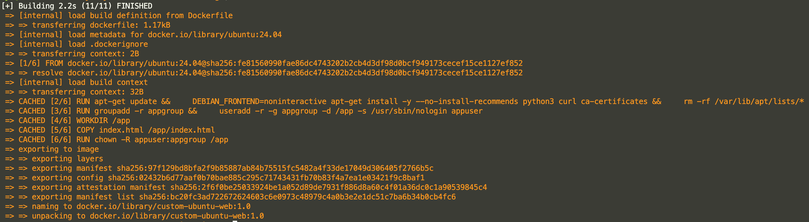
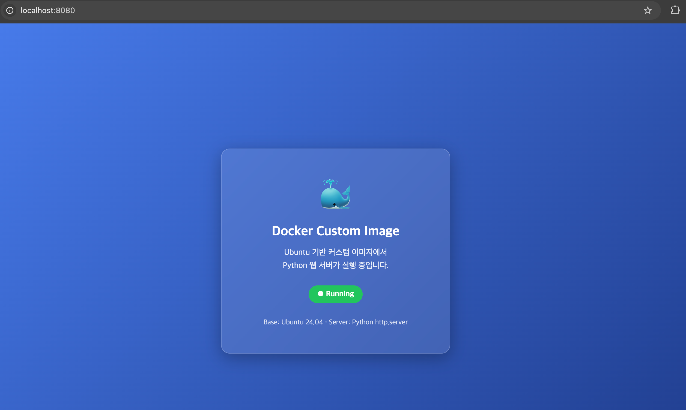
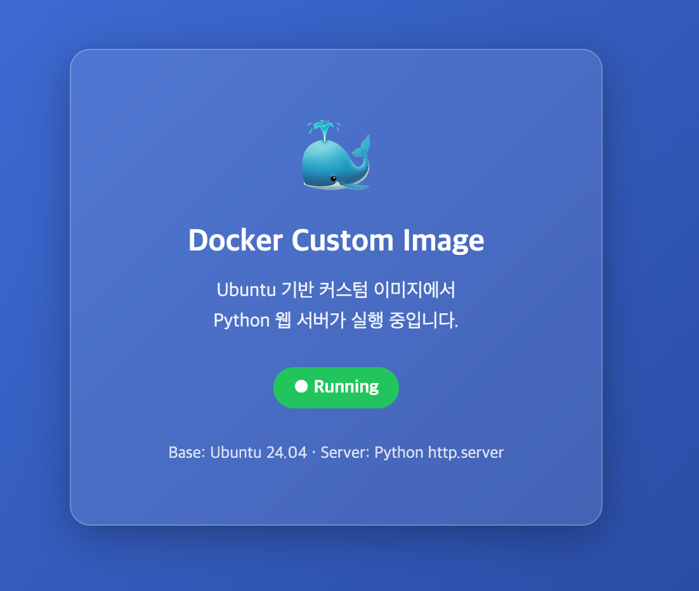
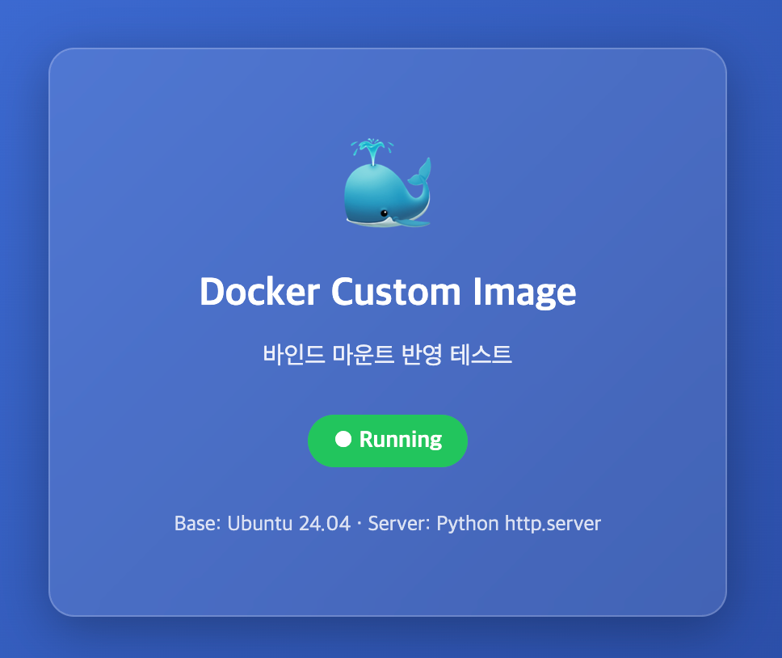
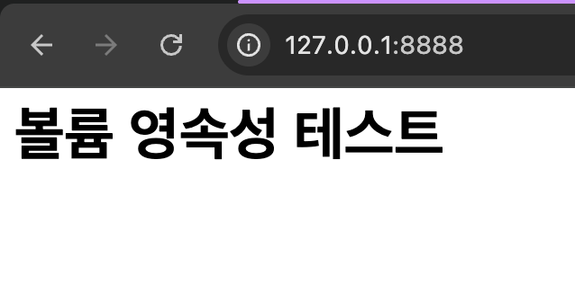
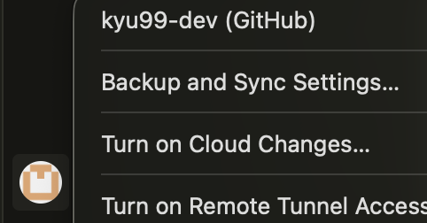
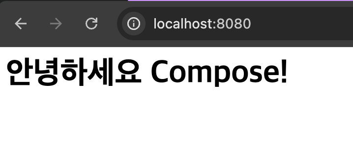
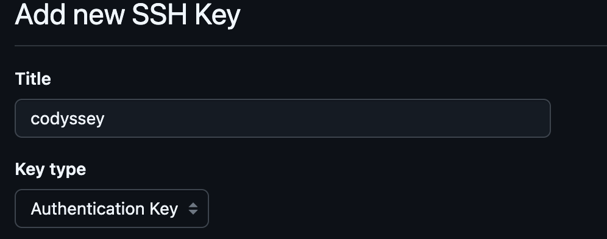

# E1-1 내 컴퓨터에 개발자용 '작업실' 꾸미기

## 프로젝트 개요(미션 목표 요약)

터미널, Docker, Git을 이용하여 개발환경을 구성하고 Docker 기반 웹 서버 실행 및 검증 과정을 GitHub에 문서화합니다.

## 1. 기술 문서

### 1) 실행 환경

 - OS: Ubuntu 26.04.1
 - Shell: bash
 - Docker: 29.9.3
 - Git: 2.53.0
 
### 2) 수행 체크리스트

 - [x] 터미널 기본 조작 및 폴더 구성
 - [x] 권한 변경 실습
 - [x] Docker 설치/점검
 - [x] hello-world 실행
 - [x] Dockerfile 빌드/실행
 - [x] 포트 매핑 접속
 - [x] 바인드 마운트 반영
 - [x] 볼륨 영속성
 - [x] Git 설정 + VSCode GitHub 연동
 - [x] 보너스 과제

### 3) 검증 방법

| 검증 항목 | 사용한 명령어 | 확인한 내용 | 결과 위치 |
|---|---|---|---|
| 터미널 기본 조작 및 폴더 구성 | `pwd`, `ls`, `mkdir`, `touch`, `cat`, `cd`, `cp`, `mv`, `rm` | 현재 위치 확인, 목록 조회, 파일/폴더 생성/이동/복사/이름변경/삭제를 수행했는지 확인 | [터미널 조작 로그 기록](#2-터미널-조작-로그-기록) |
| 파일/폴더 권한 변경 확인 | `ls -l`, `chmod`, `cat` | 권한 변경 전후의 파일/폴더 접근 가능 여부와 권한 표시 변화를 확인 | [권한 실습 및 증거 기록](#3-권한-실습-및-증거-기록) |
| Docker 설치 및 데몬 동작 확인 | `docker --version`, `docker info` | Docker 버전 출력 여부와 Docker 데몬이 정상 동작하는지 확인 | [Docker 설치 및 기본 점검](#4-docker-설치-및-기본-점검) |
| Docker 이미지 다운로드 및 목록 확인 | `docker pull`, `docker images` | 이미지가 정상적으로 다운로드되고 이미지 목록에 표시되는지 확인 | [Docker 기본 운영 명령 수행](#5-docker-기본-운영-명령-수행) |
| 컨테이너 실행/중지/목록 확인 | `docker run`, `docker stop`, `docker ps`, `docker ps -a` | 컨테이너 실행, 중지, 실행 중 목록과 전체 목록의 차이를 확인 | [Docker 기본 운영 명령 수행](#5-docker-기본-운영-명령-수행) |
| 컨테이너 로그 및 리소스 확인 | `docker logs`, `docker stats` | 컨테이너 로그 출력과 실행 중 컨테이너의 리소스 사용량을 확인 | [Docker 기본 운영 명령 수행](#5-docker-기본-운영-명령-수행) |
| hello-world 및 Ubuntu 컨테이너 실행 확인 | `docker run hello-world`, `docker run -it ubuntu bash` | hello-world 실행 메시지와 Ubuntu 컨테이너 내부 진입을 확인 | [컨테이너 실행 실습](#6-컨테이너-실행-실습) |
| 컨테이너 종료/유지 및 재접속 확인 | `exit`, `Ctrl + P + Q`, `docker attach`, `docker exec` | 컨테이너가 종료되는 경우와 유지되는 경우, attach/exec 접속 차이를 확인 | [컨테이너 실행 실습](#3-컨테이너-종료유지-차이) |
| 웹페이지 한글 깨짐 해결 확인 | `curl`, `docker exec` | 문자 인코딩(UTF-8) 설정 전후로 한글이 정상 표시되는지 확인 | [트러블슈팅 1 — 웹페이지 한글 깨짐](#트러블슈팅-1--웹페이지-한글-깨짐) |
| Git 설정 및 GitHub 연동 | `git config`, `ssh-keygen` | 사용자 정보 설정 및 SSH 키 등록을 통한 원격 저장소 연결 확인 | [Git-설정-및-GitHub-연동](#9-git-설정-및-github-연동) |
| 바인드 마운트 폴더 소유권 문제 해결 확인 | `ls -l`, `chown`, `docker run -u` | 바인드 마운트 폴더가 root 소유로 생성되는 현상과 소유권/실행 사용자 변경 후 접근 가능 여부를 확인 | [트러블슈팅 2 — 바인드 마운트 폴더가 root 소유로 생성됨](#트러블슈팅-2--바인드-마운트-폴더가-root-소유로-생성됨) |
| Docker Compose 기초 동작 확인 | `docker compose up -d`, `docker compose ps`, `docker compose down` | Compose 파일로 단일 서비스가 정상 기동·조회·종료되는지 확인 | [Docker Compose 기초](#1-docker-compose-기초) |
| 멀티 컨테이너 통신 확인 | `docker compose up -d`, `docker compose logs`, `docker compose exec` | 여러 서비스가 함께 기동되고 서비스명으로 상호 통신되는지 확인 | [Docker Compose 멀티 컨테이너](#2-docker-compose-멀티-컨테이너) |
| 환경 변수 주입 및 적용 확인 | `docker compose exec`, `printenv`, `docker compose config` | `.env` 설정값이 컨테이너 내부 환경 변수로 정상 주입되는지 확인 | [환경 변수 활용](#3-환경-변수-활용) |
| GitHub SSH 키 설정 및 연결 확인 | `git config`, `git remote -v`|GitHub 인증이 성공하고 SSH 주소로 push가 정상 동작하는지 확인 | [GitHub SSH 키 설정](#4-github-ssh-키-설정) |

## 2. 터미널 조작 로그 기록

### 1) 현재 위치 확인 

`pwd` 명령어를 사용하여 현재 작업 디렉터리의 경로를 확인하였다.

```text
kyu@localhost:~$ pwd
/home/kyu
```
### 2) 목록 확인(숨김 파일 포함)

`ls -al` 명령어를 사용하여 현재 디렉터리의 파일 및 디렉터리 목록을 숨김 파일까지 포함하여 확인하였다.

```text
kyu@localhost:~$ ls -al
total 40
drwxr-x--- 4 kyu  kyu  4096 Nov  4 09:40 .
drwxr-xr-x 3 root root 4096 Nov  4 08:51 ..
-rw------- 1 kyu  kyu   186 Nov  4 09:40 .bash_history
-rw-r--r-- 1 kyu  kyu   220 Nov  4 08:51 .bash_logout
-rw-r--r-- 1 kyu  kyu  3771 Nov  4 08:51 .bashrc
drwxr-x--- 4 kyu  kyu  4096 Nov  4 08:57 .cache
drwxr-x--- 3 kyu  kyu  4096 Nov  4 08:57 .config
-rw-rw-r-- 1 kyu  kyu     0 Nov  4 08:57 .motd_shown
-rw-r--r-- 1 kyu  kyu   807 Nov  4 08:51 .profile
-rw------- 1 kyu  kyu   860 Nov  4 09:39 .viminfo
-rw-r--r-- 1 kyu  kyu  2035 Nov  4 09:39 install_docker.sh
```

### 3) 생성, 이동, 복사, 이름변경, 삭제

#### 3-1) 생성

`mkdir` 명령어를 사용하여 `abc` 디렉터리를 생성하였다.  
이후 `ls` 명령어로 생성된 디렉터리를 확인하였다.

```text
kyu@localhost:~$ mkdir abc
kyu@localhost:~$ ls
abc  install_docker.sh
```
#### 3-2) 이동

`cd` 명령어를 사용하여 `abc` 디렉터리로 이동하였다.  
`pwd` 명령어로 현재 위치가 `/home/kyu/abc`로 변경되었는지 확인하였다.

```text
kyu@localhost:~$ cd ./abc
kyu@localhost:~/abc$ pwd
/home/kyu/abc
```

#### 3-3) 복사

`touch` 명령어로 빈 파일 `a1`을 생성한 뒤, `cp` 명령어를 사용하여 `a1`을 `a2`로 복사하였다.  
이후 `ls -l` 명령어로 두 파일이 존재하는지 확인하였다.


```text
kyu@localhost:~/abc$ touch a1
kyu@localhost:~/abc$ cp ./a1 ./a2
kyu@localhost:~/abc$ ls -l
total 0
-rw-r--r-- 1 kyu kyu 0 Nov  4 09:53 a1
-rw-r--r-- 1 kyu kyu 0 Nov  4 09:53 a2
-rw-r--r-- 1 kyu kyu 0 Nov  4 09:51 abc
```

#### 3-4) 이름 변경

`mv` 명령어를 사용하여 `a2` 파일의 이름을 `b2`로 변경하였다.  
이후 `ls -l` 명령어로 파일명이 변경되었는지 확인하였다.

```text
kyu@localhost:~/abc$ ls -l
total 0
-rw-r--r-- 1 kyu kyu 0 Nov  4 09:53 a1
-rw-r--r-- 1 kyu kyu 0 Nov  4 09:53 a2
-rw-r--r-- 1 kyu kyu 0 Nov  4 09:51 abc

kyu@localhost:~/abc$ mv ./a2 ./b2
kyu@localhost:~/abc$ ls -l
total 0
-rw-r--r-- 1 kyu kyu 0 Nov  4 09:53 a1
-rw-r--r-- 1 kyu kyu 0 Nov  4 09:51 abc
-rw-r--r-- 1 kyu kyu 0 Nov  4 09:53 b2
```
#### 3-5) 삭제

`rm` 명령어를 사용하여 `b2` 파일을 삭제하였다.  
이후 `ls -l` 명령어로 `b2` 파일이 삭제되었는지 확인하였다.

```text
kyu@localhost:~/abc$ rm ./b2
kyu@localhost:~/abc$ ls -l
total 0
-rw-r--r-- 1 kyu kyu 0 Nov  4 09:53 a1
-rw-r--r-- 1 kyu kyu 0 Nov  4 09:51 abc
```

### 4) 파일 내용 확인, 빈 파일 생성

#### 4-1) 빈 파일 생성

`touch` 명령어를 사용하여 `test`라는 빈 파일을 생성하였다.  
이후 `cat` 명령어로 파일 내용을 확인했지만, 빈 파일이기 때문에 출력되는 내용은 없었다.

```text
kyu@localhost:~/abc$ touch test
kyu@localhost:~/abc$ cat ./test
```

#### 4-2) 파일 내용 확인

`cat` 명령어를 사용하여 `install_docker.sh` 파일의 내용을 확인하였다.  
출력 내용이 길기 때문에 README에는 일부 내용을 생략하여 기록하였다.

```text
kyu@localhost:~$ cat ./install_docker.sh 
#!/usr/bin/env bash
set -e

echo "=== Docker 설치 스크립트 시작 ==="

# ... 중략 ...

echo "=== Docker 설치 완료 ==="
```

## 3. 권한 실습 및 증거 기록

### 1) 권한 확인/변경


리눅스 권한은 숫자로 표현할 수 있으며, 읽기 권한은 4, 쓰기 권한은 2, 실행 권한은 1이다.  

권한 숫자의 각 자리는 다음을 의미한다.

- 백의 자리: 소유자 권한
- 십의 자리: 그룹 권한
- 일의 자리: 기타 사용자 권한

예를 들어 `chmod 600 a1`은 소유자에게 읽기(4)와 쓰기(2) 권한을 부여하고, 그룹과 기타 사용자에게는 아무 권한도 부여하지 않는다는 의미이다.


#### 1-1) 파일

`ls -l` 명령어를 사용하여 파일의 권한을 확인하였다.  
이후 `chmod 600 a1` 명령어를 사용하여 `a1` 파일의 권한을  변경하였다.

```text
kyu@localhost:~/abc$ ls -l
total 0
-rw-r--r-- 1 kyu kyu 0 Nov  4 09:53 a1
-rw-r--r-- 1 kyu kyu 0 Nov  4 09:51 abc
-rw-r--r-- 1 kyu kyu 0 Nov  4 09:57 test
kyu@localhost:~/abc$ chmod 600 a1
kyu@localhost:~/abc$ ls -al
total 8
drwxr-xr-x 2 kyu kyu 4096 Nov  4 09:57 .
drwxr-x--- 5 kyu kyu 4096 Nov  4 09:47 ..
-rw------- 1 kyu kyu    0 Nov  4 09:53 a1
-rw-r--r-- 1 kyu kyu    0 Nov  4 09:51 abc
-rw-r--r-- 1 kyu kyu    0 Nov  4 09:57 test
```
`a1` 파일의 권한이 `-rw-r--r--`에서 `-rw-------`로 변경된 것을 확인하였다.

#### 권한 변경 전/후 차이

권한 변경 전에는 파일에 읽기 권한이 있었기 때문에 `cat` 명령어를 실행할 수 있었다.

```text
kyu@localhost:~/abc$ ls -l
-r-------- 1 kyu kyu    2 Nov  4 16:29 a1

kyu@localhost:~/abc$ cat ./a1
a

kyu@localhost:~/abc$ chmod 300 a1
```
`--wx------ 1 kyu kyu    2 Nov  4 16:29 a1` 읽기 권한이 없을 경우 파일을 읽을 수 없었다
```text
kyu@localhost:~/abc$ cat ./a1
cat: ./a1: Permission denied
```

#### 1-2) 폴더

`ls -al` 명령어를 사용하여 디렉터리의 권한을 확인하였다.  
이후 `chmod 700 ./aaa` 명령어를 사용하여 `aaa` 디렉터리의 권한을 소유자만 읽기/쓰기/실행 가능하도록 변경하였다.

```text
kyu@localhost:~/abc$ ls -al
total 12
drwxr-xr-x 3 kyu kyu 4096 Nov  4 10:25 ./
drwxr-x--- 5 kyu kyu 4096 Nov  4 09:47 ../
-rw------- 1 kyu kyu    0 Nov  4 09:53 a1
dr-x------ 2 kyu kyu 4096 Nov  4 10:27 aaa/
-rwx------ 1 kyu kyu    0 Nov  4 09:51 abc*
-rw-r--r-- 1 kyu kyu    0 Nov  4 09:57 test
kyu@localhost:~/abc$ chmod 700 ./aaa
kyu@localhost:~/abc$ ls -l
total 4
-rw------- 1 kyu kyu    0 Nov  4 09:53 a1
drwx------ 2 kyu kyu 4096 Nov  4 10:27 aaa
-rwx------ 1 kyu kyu    0 Nov  4 09:51 abc
-rw-r--r-- 1 kyu kyu    0 Nov  4 09:57 test
```

`aaa` 디렉터리의 권한이 `dr-x------`에서 `drwx------`로 변경된 것을 확인하였다.

#### 권한 변경 전/후 차이

디렉터리에 읽기 권한과 실행 권한이 있으면 디렉터리 내부 목록을 확인할 수 있다.

```text
kyu@localhost:~/abc$ ls -l
total 8
--wx------ 1 kyu kyu    2 Nov  4 16:29 a1
drwx------ 2 kyu kyu 4096 Nov  4 10:27 aaa
-rwx------ 1 kyu kyu    0 Nov  4 09:51 abc
-rw-r--r-- 1 kyu kyu    0 Nov  4 09:57 test
kyu@localhost:~/abc$ ls -l ./aaa
total 0
-rw-r--r-- 1 kyu kyu 0 Nov  4 10:27 abc
```

위 결과에서 `aaa` 디렉터리는 `drwx------` 권한을 가지고 있다.  
소유자에게 읽기 권한과 실행 권한이 있으므로 `ls -l ./aaa` 명령어로 내부 파일 목록을 확인할 수 있다.

디렉터리에서 읽기 권한이 제거되면 내부 목록을 확인할 수 없다.

```text
kyu@localhost:~/abc$ ls -l
total 8
--wx------ 1 kyu kyu    2 Nov  4 16:29 a1
d-wx------ 2 kyu kyu 4096 Nov  4 10:27 aaa
-rwx------ 1 kyu kyu    0 Nov  4 09:51 abc
-rw-r--r-- 1 kyu kyu    0 Nov  4 09:57 test
kyu@localhost:~/abc$ ls -l ./aaa
ls: cannot open directory './aaa': Permission denied
```

디렉터리 내부의 파일 목록을 조회할 수 없어 `Permission denied` 오류가 발생한다.

하지만 실행 권한이 남아 있으면, 파일 이름을 이미 알고 있는 경우 해당 경로로 접근할 수 있다.

```text
kyu@localhost:~/abc$ ls -l
total 12
--wx------ 1 kyu kyu    2 Nov  4 16:29 a1
d-wx------ 2 kyu kyu 4096 Nov  4 16:40 aaa
-rwx------ 1 kyu kyu    4 Nov  4 16:39 abc
-rw-r--r-- 1 kyu kyu    0 Nov  4 09:57 test
kyu@localhost:~/abc$ cat ./aaa/abc
abc
```
읽기 권한이 없어 목록 조회는 불가능하지만, 실행 권한이 있으면 이미 알고 있는 파일명에 대해서는 직접 접근할 수 있다.

## 4. Docker 설치 및 기본 점검

`docker --version` 명령어를 사용하여 Docker가 설치되어 있는지와 설치된 버전을 확인하였다.

### 1) 버전

```text
kyu@localhost:~/abc$ docker --version
Docker version 29.9.3, build 5457199
```

### 2) 데몬 동작 여부 확인

`docker info` 명령어를 사용하여 Docker 클라이언트와 서버 정보가 정상적으로 출력되는지 확인하였다.  
`Server` 항목이 출력되므로 Docker 데몬이 정상적으로 동작하고 있음을 확인할 수 있었다.

```text
kyu@localhost:~/abc$ docker info
Client: Docker Engine - Community
 Version:    29.9.3
 Context:    default
 Debug Mode: false
 Plugins:
  buildx: Docker Buildx (Docker Inc.)
    Version:  v0.38.1
    Path:     /usr/libexec/docker/cli-plugins/docker-buildx
  compose: Docker Compose (Docker Inc.)
    Version:  v5.7.0
    Path:     /usr/libexec/docker/cli-plugins/docker-compose

Server:
 Containers: 1
  Running: 0
  Paused: 0
  Stopped: 1
 Images: 1
 Server Version: 29.9.3

... 생략 ...
```

## 5. Docker 기본 운영 명령 수행

### 1) 이미지 다운로드/목록 확인

#### 1-1) 이미지 다운로드

`docker pull hello-world` 명령어를 사용하여 `hello-world` 이미지를 다운로드하였다.


```text
kyu@localhost:~/abc$ docker pull hello-world
Using default tag: latest
latest: Pulling from library/hello-world
4f55086f7dd0: Pull complete 
d5e71e642bf5: Download complete 
Digest: sha256:c567b231f65614688711a75f31518a064258a51d442117a3e771a3a8fdba78ef
Status: Downloaded newer image for hello-world:latest
docker.io/library/hello-world:latest
```

#### 1-2) 이미지 목록 확인

`docker images` 명령어를 사용하여 로컬에 저장된 Docker 이미지 목록을 확인하였다.

```text
kyu@localhost:~/abc$ docker images

IMAGE                ID             DISK USAGE   CONTENT SIZE   EXTRA
hello-world:latest   c567b231f656       25.9kB         9.49kB    U  
```
위 결과를 통해 hello-world:latest 이미지가 로컬에 저장된 것을 확인하였다.


### 2) 컨테이너 : 실행/중지/목록 확인

컨테이너 확인을 위해 `docker run hello-world` 명령어를 사용하여 `hello-world` 컨테이너를 실행하였다.

`docker ps`는 현재 실행 중인 컨테이너만 보여준다.  
`docker ps -a`는 실행 중인 컨테이너와 종료된 컨테이너를 모두 보여준다.

`hello-world` 컨테이너는 실행 후 바로 종료되므로 별도의 `docker stop` 명령어를 사용하지 않았다.  
따라서 `docker ps`에는 보이지 않고, `docker ps -a`에서 `Exited (0)` 상태로 확인할 수 있었다.

```text
kyu@localhost:~/abc$ docker ps
CONTAINER ID   IMAGE     COMMAND   CREATED   STATUS    PORTS     NAMES
kyu@localhost:~/abc$ docker ps -a
CONTAINER ID   IMAGE         COMMAND    CREATED         STATUS                     PORTS     NAMES
af96a2c1d0ff   hello-world   "/hello"   8 minutes ago   Exited (0) 8 minutes ago             romantic_bell
```

### 3) 운영 : 로그 확인, 리소스 확인

#### 3-1) 로그 확인

`docker logs` 명령어를 사용하여 `hello-world` 컨테이너의 실행 로그를 확인하였다.

```text
kyu@localhost:~/abc$ docker logs af96a2c1d0ff

Hello from Docker!
This message shows that your installation appears to be working correctly.

To generate this message, Docker took the following steps:
 1. The Docker client contacted the Docker daemon.
 
 ... 생략 ...
```

#### 3-2) 리소스 확인

리소스 확인을 위해 Ubuntu 컨테이너를 실행하였다.

```bash
docker run -it --name ubuntu-test ubuntu bash
```

`docker stats --no-stream` 명령어를 사용하여 실행 중인 ubuntu 컨테이너의 리소스 사용량을 한 번만 출력하여 확인하였다.

```text
kyu@localhost:~$ docker stats --no-stream 059dfa2d84f9
CONTAINER ID   NAME          CPU %     MEM USAGE / LIMIT    MEM %     NET I/O         BLOCK I/O     PIDS
059dfa2d84f9   ubuntu-test   0.00%     3.02MiB / 15.25GiB   0.02%     1.53kB / 126B   20.2MB / 0B   1
```

`docker stats`를 통해 실행 중인 컨테이너의 CPU 사용률, 메모리 사용량, 네트워크 입출력, 블록 입출력, 프로세스 수를 확인하였다.

## 6. 컨테이너 실행 실습

### 1) hello-world 실행

```text
kyu@localhost:~/abc$ docker run hello-world

Hello from Docker!
This message shows that your installation appears to be working correctly.

To generate this message, Docker took the following steps:
 1. The Docker client contacted the Docker daemon.
 2. The Docker daemon pulled the "hello-world" image from the Docker Hub.
    (amd64)
 3. The Docker daemon created a new container from that image which runs the
    executable that produces the output you are currently reading.
 4. The Docker daemon streamed that output to the Docker client, which sent it
    to your terminal.

To try something more ambitious, you can run an Ubuntu container with:
 $ docker run -it ubuntu bash

Share images, automate workflows, and more with a free Docker ID:
 https://hub.docker.com/

For more examples and ideas, visit:
 https://docs.docker.com/get-started/
```

### 2) ubuntu 실행 및 명령어 입력
```text
kyu@localhost:~/abc$ docker run -it ubuntu bash
root@505fe645233a:/# pwd
/
root@505fe645233a:/# ls
bin   dev  home  lib64  mnt  proc  run   srv  tmp  var
boot  etc  lib   media  opt  root  sbin  sys  usr
root@505fe645233a:/# cd ./home
root@505fe645233a:/home# echo 'Hello'
Hello
```

### 3) 컨테이너 종료/유지 차이

#### 3-1) 종료되는 경우

Ubuntu 컨테이너 안에서 `exit`을 입력하면 컨테이너가 종료된다.

```text
kyu@localhost:~/abc$ docker ps -a
CONTAINER ID   IMAGE     COMMAND   CREATED              STATUS                      PORTS     NAMES
65f994892265   ubuntu    "bash"    About a minute ago   Exited (0) 12 seconds ago             ubuntu-test1
```

#### 3-2) 유지되는 경우

컨테이너 안에서 `exit`을 입력하지 않고 `Ctrl + P`, `Ctrl + Q`로 빠져나오면 컨테이너는 계속 실행된다.

```text
kyu@localhost:~$ docker run -it --name ubuntu-test ubuntu bash
root@ceeac2d4b7cd:/# 
```

`Ctrl + P`, `Ctrl + Q`로 빠져나온 뒤 확인하였다.

```text
kyu@localhost:~$ docker ps
CONTAINER ID   IMAGE     COMMAND   CREATED          STATUS          PORTS     NAMES
ceeac2d4b7cd   ubuntu    "bash"    32 seconds ago   Up 32 seconds             ubuntu-test
```
`STATUS`가 `Up`으로 표시되므로 컨테이너가 종료되지 않고 유지되고 있음을 확인하였다.


#### 3-3) attach/exec

`docker attach ubuntu-test` 명령어를 사용하여 실행 중인 컨테이너의 메인 프로세스에 접속하였다.  
이 상태에서 `exit` 명령어를 입력하면 컨테이너의 메인 프로세스가 종료되므로 컨테이너도 함께 종료됨을 확인하였다.

```text
kyu@localhost:~$ docker attach ubuntu-test
root@059dfa2d84f9:/# exit
exit
kyu@localhost:~$ docker ps
CONTAINER ID   IMAGE     COMMAND   CREATED   STATUS    PORTS     NAMES
kyu@localhost:~$ docker ps -a
CONTAINER ID   IMAGE     COMMAND   CREATED             STATUS                     PORTS     NAMES
059dfa2d84f9   ubuntu    "bash"    About an hour ago   Exited (0) 4 seconds ago             ubuntu-test
```

종료된 컨테이너를 다시 실행하였다.

```bash
docker start ubuntu-test
```

`docker exec -it ubuntu-test <command>` 명령어를 사용하면 실행 중인 컨테이너 안에서 새로운 프로세스를 실행할 수 있다.  
예를 들어 `bash`를 실행한 경우, `exit`로 bash을 종료해도 컨테이너의 메인 프로세스는 종료되지 않으므로 컨테이너가 계속 실행됨을 확인하였다.

```text
kyu@localhost:~$ docker exec -it ubuntu-test bash
root@059dfa2d84f9:/# exit
exit
kyu@localhost:~$ docker ps
CONTAINER ID   IMAGE     COMMAND   CREATED             STATUS          PORTS     NAMES
059dfa2d84f9   ubuntu    "bash"    About an hour ago   Up 55 seconds             ubuntu-test
```


## 7. 기존 Dockerfile 기반 커스텀 이미지 제작

### 📁 관련 파일

- [📄 Dockerfile](docker/Dockerfile) — 커스텀 이미지 설정 파일
- [🗒️ index.html](docker/index.html) — 메인 페이지 소스

docker 폴더 안에 도커 설정 파일인 Dockerfile과 웹 서버에서 제공할 index.html 파일을 구성하였다.


### 1) 선택한 기존 베이스
**(B) Linux 베이스 이미지 + 기본 기능 추가**


### 1-1) 선택한 베이스 이미지

```dockerfile
FROM ubuntu:24.04
```
**Ubuntu 24.04 공식 이미지**를 베이스로 선택했습니다.

### 1-2) 선택 이유

| 항목 | 내용 |
|---|---|
| 방식 | Linux 베이스 이미지 + 기본 기능 추가 방식 |
| 안정성 | 공식 이미지라 신뢰성이 높고 자료가 풍부함 |
| 확장성 | `apt` 패키지 관리로 필요한 기능을 자유롭게 추가 가능 |
| 학습 목적 | 패키지 설치, 사용자 생성 등 커스터마이징 과정을 직접 구성 가능 |

> Ubuntu를 선택하여 실제 서버 환경과 유사한 구성을 경험하도록 했습니다.

---

### 1-3) 적용한 커스텀 포인트와 목적

| 커스텀 포인트 | 코드 | 목적 요약 |
|---|---|---|
| 베이스 이미지 | `FROM ubuntu:24.04` | Linux 기반 환경 구성 |
| 환경변수 | `ENV APP_HOME=/app`, `ENV APP_PORT=8080` | 경로·포트 값을 변수화하여 재사용성 향상 |
| 대화형 방지 | `ENV DEBIAN_FRONTEND=noninteractive` | 패키지 설치 중 대화형 프롬프트 차단 (빌드 중단 방지) |
| 패키지 설치 | `apt-get install -y python3 curl ca-certificates` | 웹 서버(python3), 헬스체크(curl), 인증서(ca-certificates) 설치 |
| 설치 최적화 | `--no-install-recommends` | 추천 패키지 제외로 이미지 크기 최소화 |
| 캐시 정리 | `rm -rf /var/lib/apt/lists/*` | apt 캐시 삭제로 이미지 용량 절감 |
| 사용자 생성 | `groupadd`, `useradd` | root가 아닌 전용 사용자 생성 (보안 강화) |
| 작업 디렉터리 | `WORKDIR ${APP_HOME}` | 작업 경로 표준화 |
| 파일 복사 | `COPY index.html ${APP_HOME}/index.html` | 정적 웹 파일을 이미지에 포함 |
| 권한 설정 | `chown -R appuser:appgroup ${APP_HOME}` | 전용 사용자에게 파일 소유권 부여 |
| 비root 실행 | `USER appuser` | 보안을 위해 일반 사용자 권한으로 실행 |
| 포트 명시 | `EXPOSE 8080` | 사용 포트 문서화 |
| 헬스체크 | `HEALTHCHECK ... curl ...` | 컨테이너 정상 동작 여부 자동 점검 |
| 실행 명령 | `CMD python3 -m http.server ...` | 컨테이너 시작 시 웹 서버 자동 실행 |

---
-> 
컨테이너는 별도의 네트워크 네임스페이스를 사용하므로, 컨테이너 내부에서 열린 포트는 기본적으로 호스트에서 바로 접근할 수 없어서
포트 포워딩을 설정해서 호스트의 특정 포트로 들어온 요청이 컨테이너 내부 포트로 전달되어, 외부에서 컨테이너 서비스를 사용할 수 있습니다.


### 2) 빌드/실행 명령 및 결과 로그
```bash
docker build -t custom-ubuntu-web:1.0 .
```



### 2-1) 포트 매핑 및 접속 증거

 - 포트를 연결할 때는 호스트에서 이미 점유 중인 포트를 사용하면 충돌이 발생하므로
ss -ltnp 또는 lsof -i :포트번호로 포트 점유 프로세스를 확인한 뒤, 해당 프로세스/서비스를 종료하거나 systemctl restart 서비스명으로 재시작한다.

```text
kyu@localhost:~/docker/custom-linux-image$ docker run -d --name ubuntu-web-container -p 8080:8080 custom-ubuntu-web:1.0
d50ebded43fe517847310740f1a9cc322f1a0b2438d7789e87b7dcb0eef1b43d
```



## 8. Docker 바인드 마운트 반영 + 볼륨 영속성 검증
### 1) 바인드 마운트 반영
```bash
docker run -d --name web-bind -p 8080:8080 -v $(pwd)/html:/app custom-ubuntu-web:1.0
```
### html/index.html 변경 전

### html/index.html 변경 후


> 절대/상대 경로 사용 권장 사항

- docker run -v에서는 호스트 쪽 경로는 $(pwd)/html처럼 절대 경로로 지정하고, 컨테이너 쪽 경로는 /app처럼 절대 경로로 지정하는 것이 안전합니다.


### 2) 볼륨 영속성

(1) 볼륨생성

```text
kyu@localhost:~/E1-1$ docker volume create my-data
my-data
```

(2) 볼륨을 연결해서 실행
```text
kyu@localhost:~/E1-1$ docker run -d --name web-vol -p 8880:8080 -v my-data:/app custom-ubuntu-web:1.0
ed81481a6367a25484269755557bc047993282a2e65f63aa87f55cf84b632fa6
```
(3) 컨테이너 안에서 데이터 생성
```text
docker exec web-vol sh -c 'echo "<meta charset="UTF-8"><h1>볼륨 영속성 테스트</h1>" > /app/index.html'
```
(4) 삭제 전
```text
kyu@localhost:~/E1-1$ docker exec web-vol cat /app/index.html
<meta charset=UTF-8><h1>볼륨 영속성 테스트</h1>
```


(5) 컨테이너 삭제
```text
kyu@localhost:~/E1-1$ docker rm -f web-vol
web-vol
```
(6) 같은 볼륨으로 새 컨테이너 생성 및 데이터 유지 확인
```text
kyu@localhost:~/E1-1$ docker run -d --name web-vol-2 -p 8888:8080 -v my-data:/app custom-ubuntu-web:1.0
2e8ebf033583d1800c295c8d5ba01105bfdea55fb0960734ea9c64b2a4e84bb4
kyu@localhost:~/E1-1$ docker exec web-vol-2 cat /app/index.html
<meta charset=UTF-8><h1>볼륨 영속성 테스트</h1>
```



## 9. Git 설정 및 GitHub 연동

```text
kyu@localhost:~/E1-1$ git config --global user.name
kyu
kyu@localhost:~/E1-1$ git config --global user.email
350639298+kyu99-dev@users.noreply.github.com
kyu@localhost:~/E1-1$ git config --global init.defaultBranch
main

kyu@localhost:~/E1-1$ git remote -v
origin  git@github.com:kyu99-dev/E1-1.git (fetch)
origin  git@github.com:kyu99-dev/E1-1.git (push)

kyu@localhost:~/E1-1$ git push
Enumerating objects: 5, done.
Counting objects: 100% (5/5), done.
Delta compression using up to 2 threads
Compressing objects: 100% (3/3), done.
Writing objects: 100% (3/3), 1.10 KiB | 1.10 MiB/s, done.
Total 3 (delta 2), reused 0 (delta 0), pack-reused 0 (from 0)
remote: Resolving deltas: 100% (2/2), completed with 2 local objects.
To github.com:kyu99-dev/E1-1.git
   ebd0...9da  main -> main
```



## 10. 트러블슈팅

### 트러블슈팅 1) — 웹페이지 한글 깨짐

**문제**
 - 바인드 마운트로 `index.html`을 실시간 수정하며 확인하는데, 브라우저에서 한글이 깨져 표시됨

**원인 가설**
- HTML 문서에 문자 인코딩 선언이 빠졌을 것이다
- 브라우저가 인코딩을 잘못 추측해 한글만 깨지는 것으로 보인다

**확인**
- 영문은 정상, 한글만 깨짐 → 인코딩 문제로 의심
- `index.html`을 열어 확인 → `<meta charset>` 선언이 없음

**해결/대안**

 - HTML에 UTF-8 인코딩 선언 추가

 - ​```html <meta charset="UTF-8"> ```

→ 브라우저가 문서를 UTF-8로 읽도록 명시하니 한글이 정상 출력됨


### 트러블슈팅 2) — 바인드 마운트 폴더가 root 소유로 생성됨

**문제**
- 바인드 마운트 폴더를 미리 만들지 않고 컨테이너를 실행하니, 폴더가 root 소유로 자동 생성되어 `index.html` 파일이 생성되지 않음

**원인 가설**
- 마운트 대상 폴더가 없으면 Docker가 자동으로 생성할 것이다
- 이때 소유자가 `root`로 잡혀 일반 사용자 권한으로는 쓰기가 안 될 것이다

**확인**

​```bash
ls -l     # 자동 생성된 폴더 소유자 확인 → root
​```

**해결/대안**

​```bash
해결: 컨테이너 실행 전에 호스트 폴더를 미리 생성
mkdir -p ./html

대안: 이미 root 소유로 생성된 경우 소유자 변경
sudo chown -R $USER ./html
​```

→ 폴더를 미리 생성하면 현재 사용자 소유로 만들어져 파일 생성 가능

## > 보너스 과제
### 1) Docker Compose 기초

#### 1-1) docker-compose.yml 기본 구조
```yml
services:              # ① 실행할 서비스들 (필수)
  web:                 # ② 서비스 이름 (내가 정함)
    image: nginx:latest  # ③ 사용할 이미지
    ports:             # ④ 포트 연결
      - "8080:80"
    volumes:           # ⑤ 파일/폴더 연결
      - ./html:/usr/share/nginx/html
```

> 💡 **들여쓰기(공백 2칸)가 매우 중요**
> YAML은 들여쓰기로 구조를 구분(Tab 말고 **스페이스** 사용하기)


#### 1-2) docker-compose 실행 & 명령어
```text
kyu@localhost:~/compose-practice$ docker compose up -d
[+] up 1/1
 ✔ Container compose-practice-web-1 Started
 ```


#### 1-3) docker-compose 종료
```text
kyu@localhost:~/compose-practice$ docker compose down
[+] down 2/2
 ✔ Container compose-practice-web-1 Removed                                                                                                                                                 0.1s
 ✔ Network compose-practice_default Removed  
```

### 2) Docker Compose 멀티 컨테이너

```text
kyu@localhost:~/compose-practice-2$ docker compose up -d
[+] up 13/13
 ✔ Image redis:latest                   Pulled                                                                                                                                              3.7s
 ✔ Network compose-practice-2_default   Created                                                                                                                                             0.0s
 ✔ Container compose-practice-2-web-1   Started                                                                                                                                             0.2s
 ✔ Container compose-practice-2-redis-1 Started                                                                                                                                             0.3s
```
docker compose ps 를 통해 두 컨테이너 떴는지 확인(STATUS UP)
```text
kyu@localhost:~/compose-practice-2$ docker compose ps
NAME                         IMAGE          COMMAND                  SERVICE   CREATED         STATUS         PORTS
compose-practice-2-redis-1   redis:latest   "docker-entrypoint.s…"   redis     5 seconds ago   Up 4 seconds   6379/tcp
compose-practice-2-web-1     nginx:latest   "/docker-entrypoint.…"   web       5 seconds ago   Up 4 seconds   0.0.0.0:8080->80/tcp, [::]:8080->80/tcp
```

web 컨테이너에서 redis로 접속 시도 결과
```text
kyu@localhost:~/compose-practice-2$ docker compose exec web bash
root@a0ff328ee005:/# apt update && apt install -y redis-tools
root@a0ff328ee005:/# redis-cli -h redis ping
PONG
```

```text
kyu@localhost:~/compose-practice-2$ docker compose logs
web-1  | /docker-entrypoint.sh: /docker-entrypoint.d/ is not empty, will attempt to perform configuration
web-1  | /docker-entrypoint.sh: Looking for shell scripts in /docker-entrypoint.d/
web-1  | /docker-entrypoint.sh: Launching /docker-entrypoint.d/10-listen-on-ipv6-by-default.sh

 ... 중략 ...

redis-1  | 1:M 10 Nov 2026 04:39:37.271 * Ready to accept connections tcp
redis-1  | 1:M 10 Nov 2026 04:39:37.271 # WARNING: Redis does not require authentication and is not protected by network restrictions. Redis will accept connections from any IP address on any network interface.
```
### 3) 환경 변수 활용
```yml
services:
  web:
    image: nginx
    environment:
      - APP_MODE=${APP_MODE}      # .env의 APP_MODE 값이 들어감
    ports:
      - "${APP_PORT}:80"          # .env의 APP_PORT 값이 들어감
```

```text
#.env
APP_MODE=development
APP_PORT=8080

```
```text
kyu@localhost:~/compose-practice-3$ docker compose up -d
[+] up 2/2
 ✔ Network compose-practice-3_default Created                                                                                                                                        0.1s
 ✔ Container compose-practice-3-web-1 Started   

 kyu@localhost:~/compose-practice-3$ docker compose exec web env |grep APP
APP_MODE=development
```

### 4) GitHub SSH 키 설정

#### ssh key 생성

```text
ssh-keygen -t ed25519 -C "your_email@example.com"
```
#### 키 등록



#### 등록확인

```text
kyu@localhost:~/.ssh$ ssh -T git@github.com

 ... 중략 ...

Hi kyu99-dev! You've successfully authenticated, but GitHub does not provide shell access.
```